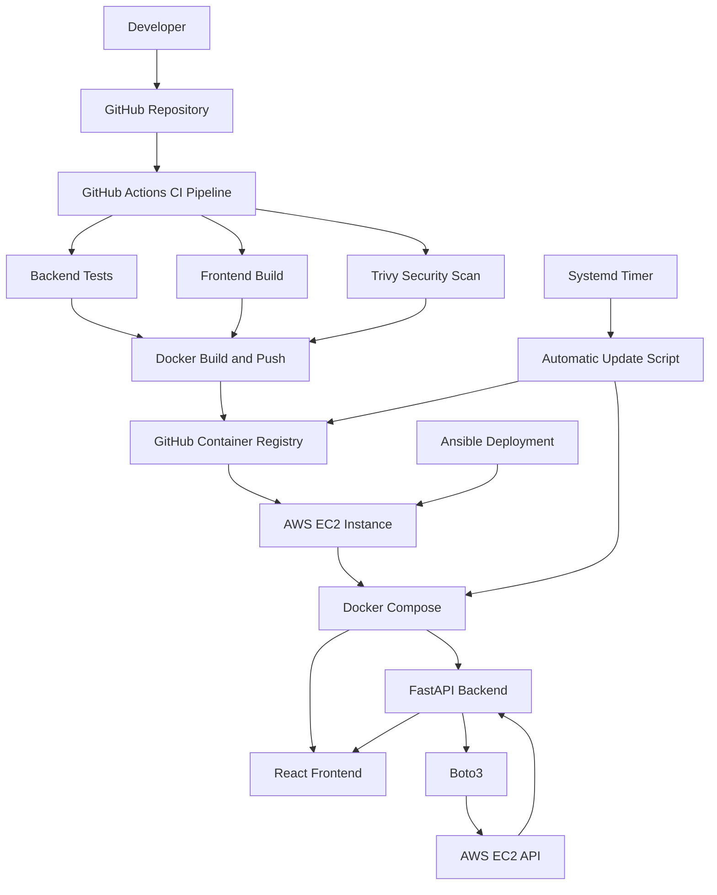

# CloudLaunch – AWS DevOps Automation Platform

CloudLaunch is a cloud-based DevOps project that demonstrates how to build, containerize, deploy, monitor, and automatically update a web application on AWS.

The project combines a React frontend, FastAPI backend, Docker containers, AWS EC2, Ansible automation, GitHub Actions CI/CD, and Trivy security scanning.

The dashboard connects to AWS and retrieves real EC2 instance information using Boto3 and an IAM instance role.

## Project Overview

CloudLaunch provides a web dashboard that displays live AWS EC2 information, including:

- Total EC2 instances
- Running EC2 instances
- Stopped EC2 instances
- AWS connection status
- AWS region
- Application environment and version

The application is deployed on an AWS EC2 instance using Docker and Ansible.

## Architecture



## Technology Stack

| Category | Technologies |
|---|---|
| Frontend | React.js, Vite, CSS |
| Backend | Python, FastAPI |
| AWS Integration | Boto3, EC2, IAM |
| Cloud Infrastructure | AWS EC2, VPC, Security Groups |
| Containerization | Docker, Docker Compose |
| Container Registry | GitHub Container Registry (GHCR) |
| Infrastructure as Code | AWS CloudFormation |
| Configuration Management | Ansible |
| CI/CD | GitHub Actions |
| Security Scanning | Trivy |
| Web Server | Nginx |
| Operating System | Ubuntu Linux |
| Automation | Linux systemd timers and services |

## Project Structure

```text
CloudLaunch/
│
├── .github/
│   └── workflows/
│       └── ci.yml
│
├── app/
│   ├── backend/
│   │   ├── main.py
│   │   ├── requirements.txt
│   │   ├── Dockerfile
│   │   └── tests/
│   │       └── test_main.py
│   │
│   └── frontend/
│       ├── src/
│       │   ├── App.jsx
│       │   ├── App.css
│       │   ├── index.css
│       │   └── main.jsx
│       ├── Dockerfile
│       ├── nginx.conf
│       └── package.json
│
├── infrastructure/
│   └── cloudformation/
│       └── cloudformation.yaml
│
├── ansible/
│   ├── inventory/
│   │   └── hosts.example.yml
│   └── playbooks/
│       ├── deploy.yml
│       └── auto-update.yml
│
├── docs/
│
├── ansible.cfg
├── .gitignore
└── .trivyignore
```

## How It Works

### 1. Frontend

The React application provides the CloudLaunch dashboard.

It sends requests to the FastAPI backend and displays the AWS information returned by the API.

### 2. Backend

The FastAPI backend provides the dashboard API.

The `/api/dashboard` endpoint retrieves EC2 instance information using Boto3.

### 3. AWS Integration

Boto3 communicates with the AWS EC2 API.

The backend uses the EC2 instance's attached IAM role to obtain permission to retrieve instance information.

The application does not require AWS access keys to be hardcoded inside the application.

### 4. Docker

Docker packages the frontend and backend into separate images.

The images are stored in GitHub Container Registry:

- `ghcr.io/ashwinsist/cloudlaunch-frontend:latest`
- `ghcr.io/ashwinsist/cloudlaunch-backend:latest`

Docker Compose manages the application containers on EC2.

### 5. Ansible Deployment

Ansible automates application deployment on the EC2 instance.

The deployment playbook:

- Installs Docker and Docker Compose.
- Creates the application directory.
- Configures Docker Compose.
- Pulls the latest container images.
- Starts the frontend and backend containers.
- Checks frontend availability.

### 6. GitHub Actions CI/CD

The GitHub Actions workflow automatically runs when code is pushed to the main branch.

The pipeline contains four jobs:

1. Backend Check – validates the Python backend and runs tests.
2. Frontend Check – installs dependencies and builds the React application.
3. Security Scan – scans the source code using Trivy.
4. Docker Build – builds, scans, and pushes the Docker images to GHCR.

The Docker build job depends on the successful completion of the preceding checks.

### 7. Automated Deployment

CloudLaunch uses a Linux systemd timer to periodically check for updated Docker images.

The automatic update script:

- Checks the currently deployed image IDs.
- Pulls the latest images from GHCR.
- Detects whether new images are available.
- Recreates containers when images change.
- Checks application health.
- Attempts to restore previous images if deployment fails.

The timer is configured to check approximately every five minutes.

## API Endpoints

| Endpoint | Description |
|---|---|
| `/` | Application welcome endpoint |
| `/health` | Backend health check |
| `/version` | Application version |
| `/api/dashboard` | Live AWS EC2 dashboard information |

### Example Dashboard Response

```json
{
  "total_deployments": null,
  "successful_deployments": null,
  "security_issues": null,
  "estimated_cloud_cost": null,
  "aws_connected": true,
  "aws_region": "ap-southeast-2",
  "total_ec2_instances": 1,
  "running_ec2_instances": 1,
  "stopped_ec2_instances": 0,
  "aws_error": null,
  "environment": "Production",
  "app_version": "1.0.1"
}
```

Deployment history, security issue counts, and estimated cloud costs are not integrated yet. These fields currently return `null` rather than displaying fabricated values.

## Running Locally

### Backend

Navigate to the backend directory:

```bash
cd app/backend
```

Create and activate a Python virtual environment:

```bash
python3 -m venv .venv
source .venv/bin/activate
```

Install dependencies:

```bash
pip install -r requirements.txt
```

Start the FastAPI application:

```bash
uvicorn main:app --reload
```

The backend will be available at:

```text
http://127.0.0.1:8000
```

API documentation:

```text
http://127.0.0.1:8000/docs
```

### Frontend

Open another terminal and navigate to the frontend:

```bash
cd app/frontend
```

Install dependencies:

```bash
npm ci
```

Start the development server:

```bash
npm run dev
```

The frontend will be available at:

```text
http://localhost:5173
```

For live AWS information, the backend must have valid AWS credentials or an appropriately configured IAM role and EC2 permissions.

## AWS Deployment

The application is deployed on an AWS EC2 instance running Ubuntu.

The deployment uses:

- AWS EC2 for application hosting.
- IAM instance role for AWS API permissions.
- Docker for application containers.
- GHCR for storing container images.
- Ansible for deployment automation.
- systemd for scheduled automatic updates.

The EC2 instance uses an IAM role with the required EC2 read permission, including `ec2:DescribeInstances`.

## Security Practices

CloudLaunch incorporates the following security practices:

- IAM roles instead of hardcoded AWS credentials on EC2.
- Restricted inbound security group rules.
- IMDSv2 requirement for instance metadata.
- Non-root users in application containers.
- Trivy vulnerability and security scanning.
- Docker image security updates.
- GitHub secrets and tokens for registry authentication.
- A `.trivyignore` file for a documented, temporary accepted finding.

## Testing and Verification

The project has been verified through:

- Backend automated tests.
- Successful frontend production build.
- GitHub Actions pipeline execution.
- Trivy security scanning in CI.
- Docker image builds and GHCR pushes.
- Successful Ansible deployment.
- Live frontend and backend health checks.
- Live AWS EC2 API integration.
- Automatic image update and application health-check execution.

## Infrastructure as Code

The repository includes an AWS CloudFormation template under:

```text
infrastructure/cloudformation/cloudformation.yaml
```

The template has been validated, but it has not been deployed as the infrastructure stack used by the currently running application.

## Future Improvements

- Integrate GitHub deployment history into the dashboard.
- Integrate security findings into the dashboard.
- Add AWS cost monitoring.
- Add application authentication and authorization.
- Add more detailed application monitoring and logging.
- Test and document automatic deployment rollback with a controlled failure scenario.

## Author

**Ashwin V**

CloudLaunch – AWS DevOps Automation Project
