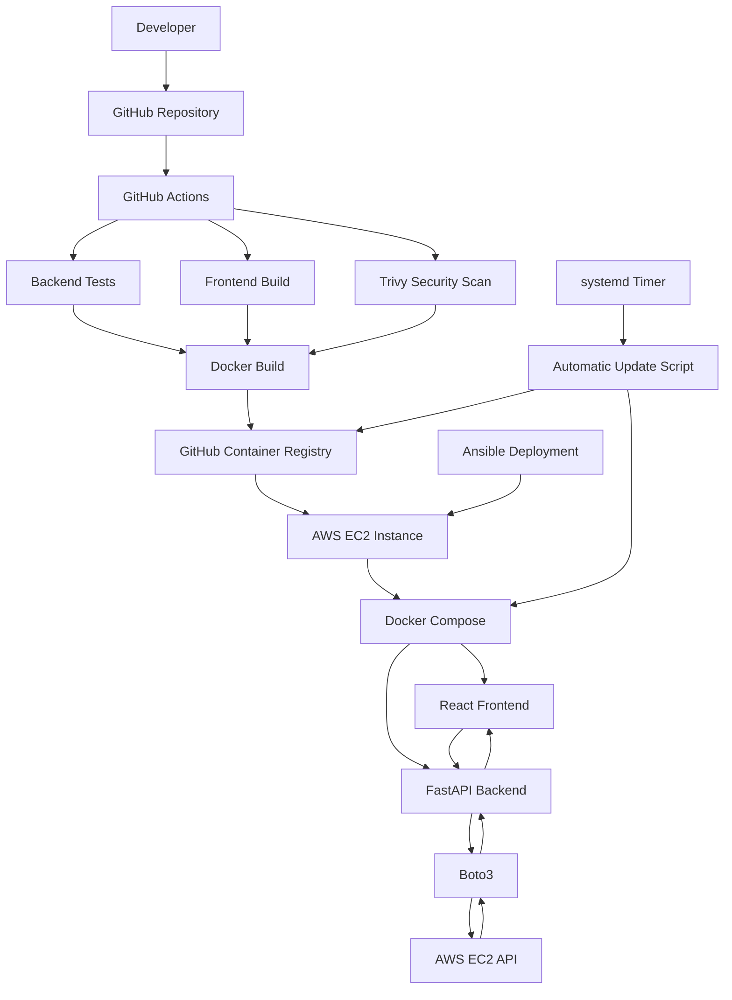
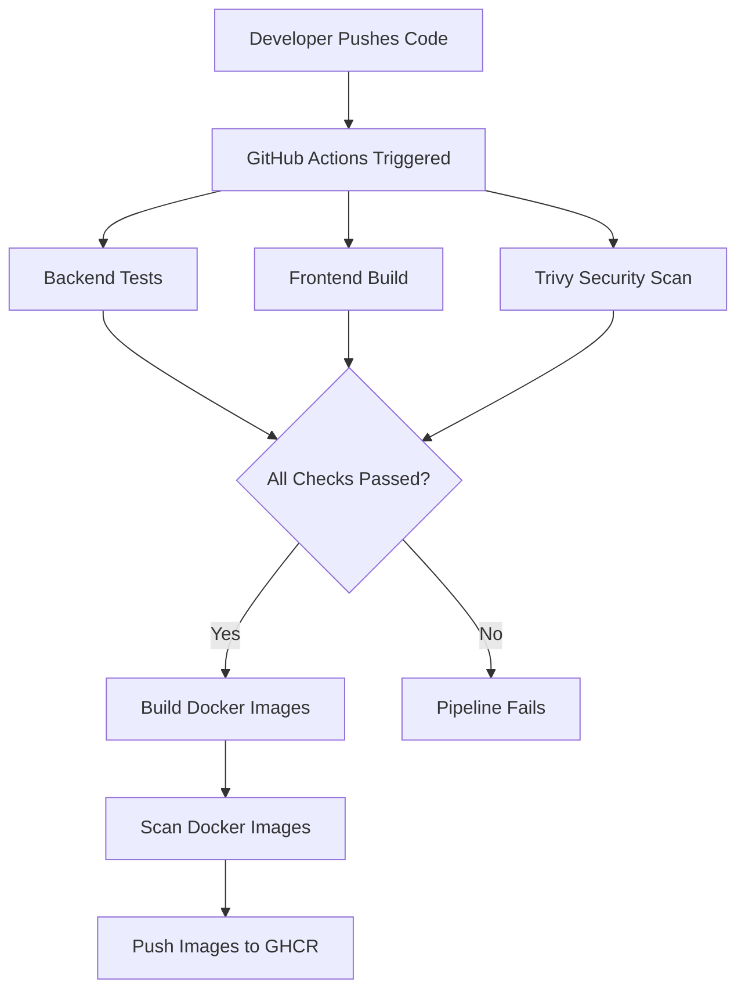
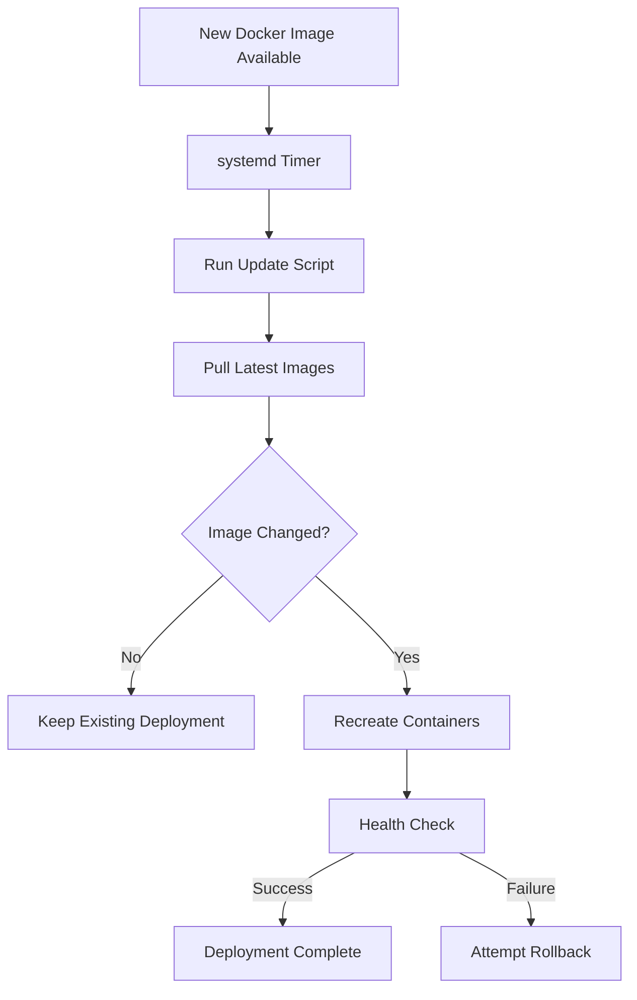

# CloudLaunch – System Architecture

## 1. Overview

CloudLaunch is an AWS-based DevOps automation platform that demonstrates application deployment, containerization, cloud integration, CI/CD automation, and continuous application updates.

The application consists of a React frontend and FastAPI backend deployed as Docker containers on an AWS EC2 instance.

## 2. High-Level Architecture

## 3. Architecture Components

### 3.1 Frontend Layer

**Technology:** React.js, Vite, CSS and Nginx.

The frontend provides the CloudLaunch dashboard.

Responsibilities:

- Display AWS EC2 information.
- Show AWS connection status.
- Communicate with the FastAPI backend.
- Display application health information.
- Present the production environment and application version.

The production frontend is served using an unprivileged Nginx container.

### 3.2 Backend Layer

**Technology:** Python, FastAPI and Boto3.

The backend provides REST API endpoints.

Responsibilities:

- Handle frontend API requests.
- Retrieve AWS EC2 instance information.
- Process AWS API responses.
- Return dashboard information as JSON.
- Provide application health and version endpoints.

Main dashboard endpoint:

`GET /api/dashboard`

### 3.3 AWS Integration Layer

**Technology:** AWS EC2, IAM and Boto3.

The backend communicates with AWS using Boto3.

The EC2 instance has an attached IAM role that grants the required EC2 read permission.

The backend uses this role to call:

`ec2:DescribeInstances`

This allows the application to retrieve real EC2 instance information without hardcoding AWS access keys.

### 3.4 Containerization Layer

**Technology:** Docker and Docker Compose.

The frontend and backend are packaged into separate Docker images.

The images are stored in GitHub Container Registry.

Frontend image:

`ghcr.io/ashwinsist/cloudlaunch-frontend:latest`

Backend image:

`ghcr.io/ashwinsist/cloudlaunch-backend:latest`

Docker Compose manages the application containers on the EC2 instance.

### 3.5 CI/CD Layer

**Technology:** GitHub Actions.

The CI pipeline automatically runs when changes are pushed to the main branch.

The pipeline contains four jobs:

1. Backend Check
2. Frontend Check
3. Security Scan
4. Docker Build

After the required checks pass, Docker images are built, scanned and pushed to GHCR.

### 3.6 Deployment Automation Layer

**Technology:** Ansible.

Ansible automates application deployment on AWS EC2.

The deployment playbook:

- Installs Docker and Docker Compose.
- Creates the application directory.
- Generates the Docker Compose configuration.
- Pulls container images.
- Starts application containers.
- Checks frontend availability.

Ansible connects to the EC2 instance through AWS Systems Manager rather than requiring public SSH access.

### 3.7 Automatic Update Layer

**Technology:** Linux systemd, Bash and Docker Compose.

A systemd timer periodically triggers the CloudLaunch update service.

The update script:

1. Checks the existing Docker image IDs.
2. Pulls the latest images from GHCR.
3. Compares old and new image IDs.
4. Recreates containers when new images are detected.
5. Checks backend application health.
6. Attempts to restore previous images if deployment fails.

The timer is configured to check approximately every five minutes.

## 4. Application Data Flow

The dashboard follows this request sequence:

1. A user opens the CloudLaunch dashboard.
2. React sends a request to the FastAPI backend.
3. FastAPI calls the dashboard endpoint.
4. Boto3 sends an EC2 API request to AWS.
5. AWS returns EC2 instance information.
6. FastAPI processes the response.
7. The backend returns JSON data.
8. React displays the information on the dashboard.

## 5. CI/CD Workflow

The automated pipeline follows this sequence:

## 6. Deployment Workflow

The deployment process uses Ansible to configure and deploy the application.

The automatic update mechanism independently checks GHCR for newer images using a systemd timer.

## 7. Security Architecture

CloudLaunch incorporates several security practices:

- IAM instance roles for AWS permissions.
- IMDSv2 for instance metadata access.
- Security groups to control network traffic.
- No public SSH access to the EC2 instance.
- Non-root application container users.
- Trivy vulnerability and security scanning.
- Secure GitHub Container Registry authentication.
- Documented temporary Trivy exceptions.

## 8. Infrastructure as Code

The repository includes an AWS CloudFormation template:

`infrastructure/cloudformation/cloudformation.yaml`

The template has been validated but has not been deployed as the infrastructure stack hosting the current live application.

## 9. Current Deployment Information

| Component | Configuration |
|---|---|
| Cloud Provider | AWS |
| Compute | EC2 |
| Operating System | Ubuntu 24.04 |
| AWS Region | ap-southeast-2 |
| Frontend | React + Nginx |
| Backend | FastAPI |
| Containers | Docker |
| Deployment | Ansible |
| CI/CD | GitHub Actions |
| Registry | GHCR |
| Security Scanning | Trivy |

## 10. Future Enhancements

- GitHub deployment history integration.
- Security findings dashboard integration.
- AWS cost monitoring.
- Authentication and authorization.
- Detailed application monitoring.
- Controlled failure testing of the rollback mechanism.

---

**Project:** CloudLaunch  
**Author:** Ashwin V  
**Category:** AWS Cloud and DevOps Automation
